# 낚시꾸니 — 낚시 여행 서비스

> SSAFY 16기 관통 프로젝트 **Web(Front) PJT — 공공데이터를 활용한 EnjoyTrip 서비스** · 광주 4반 FrontEnd 8팀

대한민국 지역을 선택하고 낚시 장소를 탐색한 뒤, 날씨·해양 정보를 확인하며 AI로 여행 일정을 구성하는 서비스입니다. HTML·CSS·JavaScript 프런트엔드와 Node.js API 프록시로 구성되며, 회원·게시글·관심 장소·여행은 브라우저 저장소에 보관합니다.

- **기술 스택:** HTML5, CSS3, JavaScript(ES2022), Node.js 20 내장 모듈(API 프록시), 카카오 Maps JavaScript SDK, 공공데이터포털 Open API, OpenAI Responses API
- **반응형 UI:** Bootstrap을 쓰지 않고 CSS Grid·Flexbox와 미디어 쿼리(1200/1000/900/640/520px)로 데스크톱·태블릿·모바일 레이아웃을 구현했습니다.

## 팀 정보

| 역할 | 이름   | 담당 기능                                                                                                                                                                                                                                                                                                                                                                                         |
| ---- | ------ | ------------------------------------------------------------------------------------------------------------------------------------------------------------------------------------------------------------------------------------------------------------------------------------------------------------------------------------------------------------------------------------------------- |
| 팀장 | 김정호 | 요구사항 명세서·화면 레이아웃 설계, 분업용 HTML/JS 구조 분리 · **회원 관리(F107)** 가입·조회·수정·탈퇴 · **로그인 관리(F108)** 로그인·로그아웃·비밀번호 찾기, 비밀번호 해시, 로그인 테스트 · 공통 모듈 `session.js` · 6개 페이지 공통 헤더 · 홈 지역 선택(전국 SVG 지도) · 마이페이지(관심 장소·등록 장소·내가 쓴 글·계정 관리) · **공유게시판(F110)** 게시글 CRUD·사진 첨부 · README 작성 |
| 팀원 | 이민호 | 지도 탐색(카카오맵) — **지역별 관광지·숙박·음식점 조회(F101·F102)**, 낚시 포인트·용품점 검색, 관심 장소 저장, **마커 대표 사진(F112)** · **hotplace 마커 등록(F105)** · 공공데이터 서버 프록시 — **날씨·기상특보(F111)**, **일출·일몰(F113)**, 조석·조위·바다낚시지수 · 홈 날씨 화면 · **AI 여행 플래너(F104)**, 마이페이지 저장 여행 상세·메모                                                      |

**작업 순서:** 요구사항 검토와 역할 분배 → 생성형 AI로 페이지별 레이아웃·아이콘 레퍼런스 확보(`img/reference_layout/`) → 공통 파일과 페이지별 HTML/JS 분리 → 화면 구현 → 브라우저 저장소 CRUD와 공공 API 연동 → 테스트·문서화


## 기능별 구현 내용

각 기능의 화면영상, 작업 내용, 관련 Source, 핵심 코드를 정리했습니다. 화면영상(gif)은 실제 서버(`127.0.0.1:5500`)에서 회원가입부터 회원 탈퇴까지 한 계정으로 이어서 클릭·입력하는 과정을 사람이 따라볼 수 있는 속도로 녹화했습니다. 화면 아래 자막에 단계 설명이 나오고, AI 응답처럼 긴 대기 시간은 줄여서 표시했습니다. 영상 속 계정은 녹화용 테스트 계정입니다.

### 1. 회원 관리 — 회원가입·조회·수정·탈퇴 (F107)

**화면영상 — 회원가입**

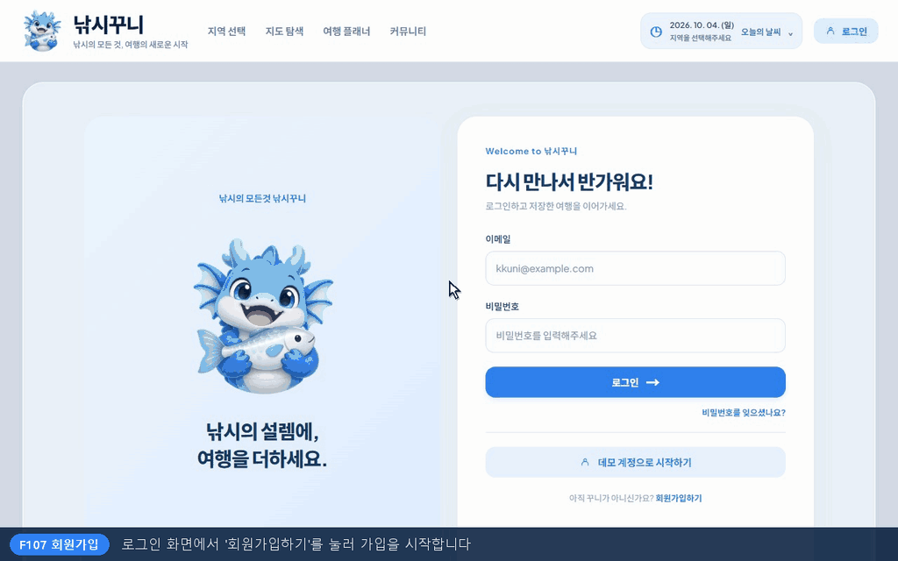

**화면영상 — 회원 조회·회원정보 수정**

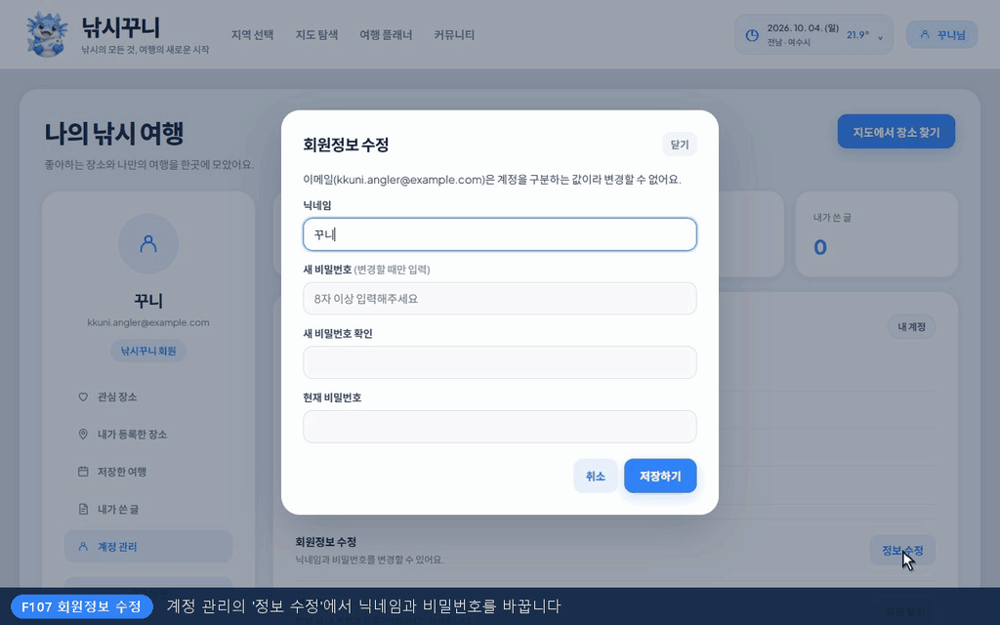

**화면영상 — 회원 탈퇴**

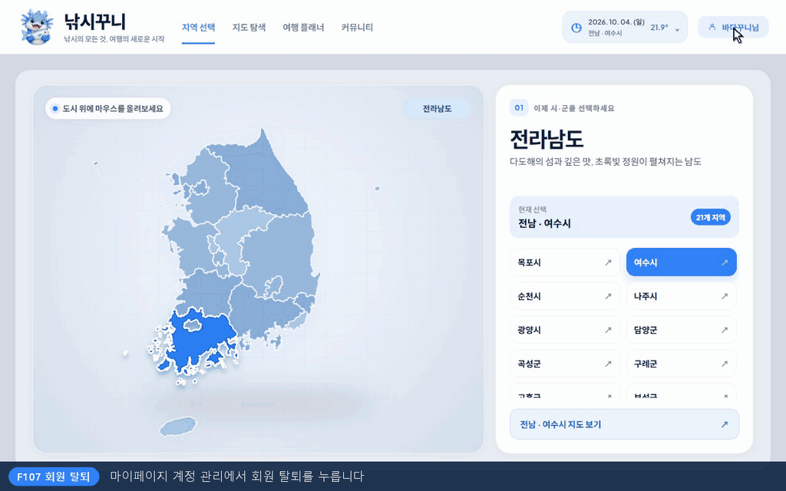

회원 조회(계정 관리 탭)는 [9. 마이페이지](#9-마이페이지) 영상에서도 볼 수 있습니다.

**작업 내용**

- **회원가입:** 로그인 화면의 회원가입 창에서 이름·이메일·비밀번호·비밀번호 확인을 받습니다. 이메일 중복과 비밀번호 일치를 검사하고, 사용자별 salt와 PBKDF2-SHA256(600,000회) 해시만 `localStorage`의 `kkuni-users`에 저장합니다. 비밀번호 원문은 저장하지 않습니다.
- **회원 조회:** 마이페이지 **계정 관리** 탭에서 닉네임·이메일·가입일·작성한 게시글 수를 표시합니다.
- **회원정보 수정:** 계정 관리 탭의 **정보 수정** 버튼으로 창을 엽니다. 현재 비밀번호를 확인한 뒤 닉네임(20자 이내)과 새 비밀번호(8자 이상, 선택)를 저장합니다. 새 비밀번호는 새 salt로 다시 해시합니다. 닉네임을 바꾸면 로그인 세션, 헤더의 `이름님` 표시, 내가 쓴 글의 작성자 이름도 함께 바뀝니다. 이메일은 모든 소유 데이터를 구분하는 값이라 변경할 수 없습니다.
- **회원 탈퇴:** 확인 문구 `탈퇴`와 현재 비밀번호를 확인한 뒤 계정과 본인 소유의 마커·관심 장소·여행·게시글·게시글 사진을 삭제하고 로그아웃합니다.

**관련 Source**

| 구분      | 화면(HTML)                                                                                                                   | 기능(JS)                                                                                                                                                        |
| --------- | ---------------------------------------------------------------------------------------------------------------------------- | --------------------------------------------------------------------------------------------------------------------------------------------------------------- |
| 회원가입  | [login.html — 회원가입 창](login.html#L157)                                                                                 | [js/login.js — `registerUser`](js/login.js#L63), [`hashPassword`](js/login.js#L47)                                                                             |
| 회원 조회 | [mypage.html — 계정 정보](mypage.html#L142)                                                                                 | [js/mypage.js — 계정 관리 탭 렌더링](js/mypage.js#L319)                                                                                                        |
| 회원 수정 | [mypage.html — 정보 수정 버튼](mypage.html#L149), [회원정보 수정 창](mypage.html#L217)                                      | [js/mypage.js — 회원정보 수정](js/mypage.js#L676), [js/session.js — `createPasswordRecord`](js/session.js#L226), [`setCurrentUser`](js/session.js#L43)        |
| 회원 탈퇴 | [mypage.html — 회원 탈퇴 창](mypage.html#L249)                                                                              | [js/mypage.js — 회원 탈퇴](js/mypage.js#L763)                                                                                                                  |

**핵심 코드** — 회원정보 수정 ([js/mypage.js](js/mypage.js#L706))

```javascript
const member = readList(KEYS.users).find((item) => item && item.email === user.email);
if (!member) throw new Error("저장된 계정 정보를 찾을 수 없습니다.");
if (!await verifyPassword(member, profileCurrentPassword.value)) {
  throw new Error("현재 비밀번호가 일치하지 않습니다.");
}
const changes = { name, updatedAt: new Date().toISOString() };
if (newPassword) Object.assign(changes, await createPasswordRecord(newPassword));

// 해시를 만드는 동안 계정이 바뀌었을 수 있어 최신 목록을 다시 읽습니다.
const users = readList(KEYS.users);
const index = users.findIndex((item) => item && item.email === user.email);
users[index] = Object.assign({}, users[index], changes);
writeList(KEYS.users, users);
// 내가 쓴 글의 작성자 이름도 새 닉네임으로 맞춥니다.
if (name !== user.name) {
  writeList(KEYS.posts, readList(KEYS.posts).map((post) =>
    post && post.ownerEmail === user.email ? Object.assign({}, post, { author: name }) : post));
}
setCurrentUser({ name, email: user.email });
```

### 2. 로그인 관리 — 로그인·로그아웃·비밀번호 찾기 (F108)

**화면영상 — 로그인과 헤더 이름 표시**

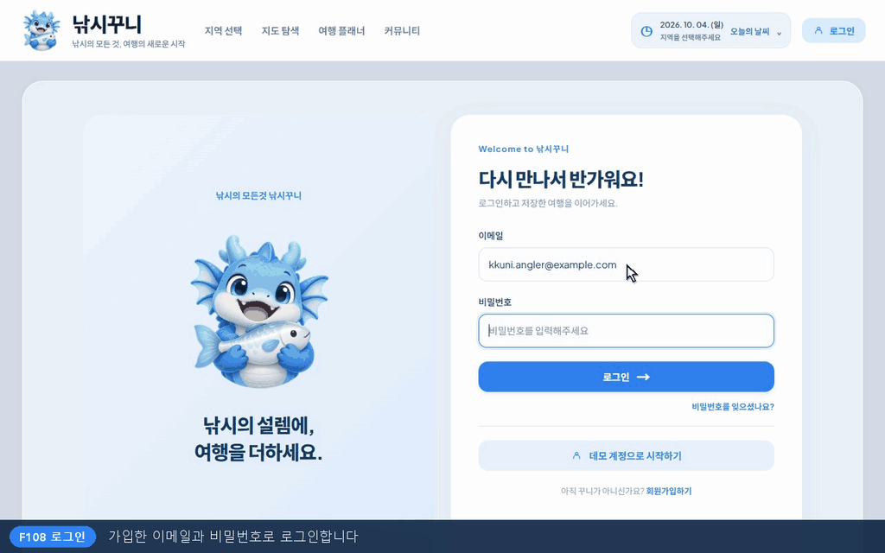

**화면영상 — 로그아웃 · 비밀번호 찾기 · 새 비밀번호로 로그인**

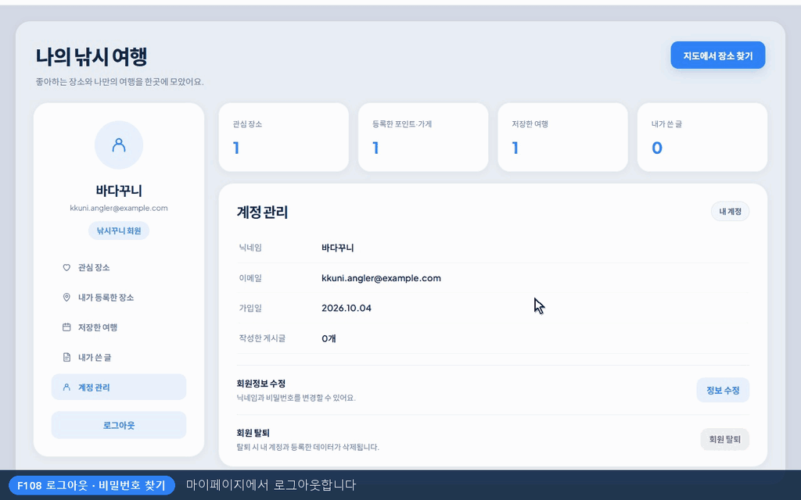

**작업 내용**

- **로그인:** 입력한 비밀번호를 저장된 salt로 해시해 회원 정보와 대조합니다. 성공하면 이름과 이메일만 `sessionStorage`의 `kkuni-current-user`에 저장하고, `login.html?next=community.html`처럼 지정된 같은 폴더의 페이지로 돌아갑니다. **데모 계정으로 시작하기** 버튼은 `demo@example.com` 계정을 처음 한 번 만든 뒤 로그인합니다.
- **헤더 로그인 표시:** 로그인하면 모든 페이지 헤더의 `로그인` 버튼이 `이름님` 마이페이지 링크로 바뀝니다.
- **로그아웃:** 마이페이지의 로그아웃 버튼으로 세션을 지우고 홈으로 이동합니다.
- **비밀번호 찾기:** 로그인 화면의 **비밀번호를 잊으셨나요?** 링크로 창을 엽니다. 가입한 이메일과 이름이 모두 일치하면 새 비밀번호(8자 이상, 확인 입력)를 새 salt로 해시해 저장합니다. 일치하는 계정이 없으면 변경하지 않습니다. 서버와 메일 발송이 없는 프런트엔드 범위이므로 본인 확인은 이메일·이름 일치로 처리했습니다. 실제 서비스에서는 메일 인증 등 서버 검증이 필요합니다.

**관련 Source**

| 구분            | 화면(HTML)                                                                                                     | 기능(JS)                                                                                                                         |
| --------------- | -------------------------------------------------------------------------------------------------------------- | -------------------------------------------------------------------------------------------------------------------------------- |
| 로그인          | [login.html — 로그인 폼](login.html#L78), [데모 계정 버튼](login.html#L125)                                    | [js/login.js — `signIn`](js/login.js#L242), [`nextPage`](js/login.js#L260), [데모 로그인](js/login.js#L284)                       |
| 헤더 표시       | 각 페이지 헤더의 `.login-link`                                                                                 | [js/session.js — `renderHeaderUser`](js/session.js#L232), [`getCurrentUser`](js/session.js#L24)                                  |
| 로그아웃        | [mypage.html — 로그아웃 버튼](mypage.html#L106)                                                                | [js/mypage.js — 로그아웃](js/mypage.js#L670), [js/session.js — `logout`](js/session.js#L34)                                      |
| 비밀번호 찾기   | [login.html — 찾기 링크](login.html#L114), [비밀번호 찾기 창](login.html#L231)                                 | [js/login.js — `resetUserPassword`](js/login.js#L86), [찾기 창 이벤트](js/login.js#L194)                                         |
| 테스트          | —                                                                                                              | [tests/login.test.cjs](tests/login.test.cjs)                                                                                     |

**핵심 코드** — 비밀번호 찾기 ([js/login.js](js/login.js#L86))

```javascript
async function resetUserPassword(email, name, password) {
  const matches = (member) => member.email === email && member.name === name;
  if (!loadUsers().some(matches)) {
    throw new Error("입력한 이메일과 이름으로 가입된 계정을 찾을 수 없습니다.");
  }
  const salt = toHex(crypto.getRandomValues(new Uint8Array(16)));
  const passwordHash = await hashPassword(password, salt, PASSWORD_ITERATIONS);

  // 해시를 만드는 동안 계정이 바뀌었을 수 있어 최신 목록을 다시 읽습니다.
  const users = loadUsers();
  const index = users.findIndex(matches);
  users[index] = Object.assign({}, users[index], {
    salt, passwordHash,
    iterations: PASSWORD_ITERATIONS,
    updatedAt: new Date().toISOString(),
  });
  saveUsers(users);
}
```

### 3. 지역 선택 홈과 날씨 (F111·F113)

**화면영상 — 지역 선택 · 공통 헤더 날씨 버튼 · 날씨 창(특보·시간별 예보·일출일몰·음력)**

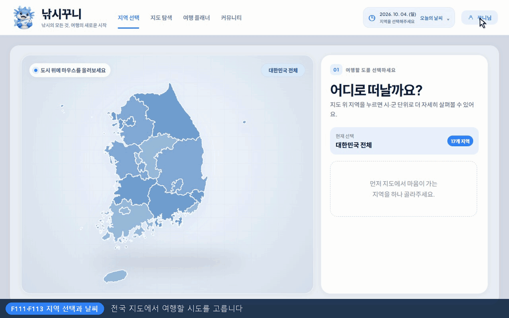

**작업 내용**

- 전국 17개 시도 SVG 지도에서 시도를 고르면 시·군·구 버튼이 나타납니다. 선택 상태를 `sessionStorage`에 저장하고 다시 방문하면 복원합니다. 지도 탐색과 날씨 조회가 같은 선택 지역을 사용합니다.
- 우측 상단 날씨 버튼을 누르면 선택 지역의 현재 날씨, 오늘 시간별 기온·하늘·강수·습도·풍속, 최신 전국 기상특보, 일출·일몰·월출·월몰과 음력 날짜를 보여줍니다. 음력 날짜는 좁은 화면에서도 한 줄로 표시하고, 윤달이면 날짜 아래에 따로 표시합니다.
- **공통 헤더:** 홈·지도 탐색·여행 플래너·커뮤니티·로그인·마이페이지 6개 페이지가 같은 헤더를 사용합니다. 우측 상단에는 모든 페이지에 홈과 같은 날짜·날씨 버튼과 로그인 버튼이 같은 위치·크기로 놓이고, 어느 페이지에서든 버튼을 누르면 홈에서 선택한 지역의 날씨 창이 열립니다. 태블릿·모바일 폭의 헤더 배치도 모든 페이지에서 같습니다.

**관련 Source:** [index.html — 시도 SVG](index.html#L62), [시군구 목록](index.html#L99), [날씨 버튼](index.html#L35), [날씨 창](index.html#L118) · [js/main.js — `initRegionSelection`](js/main.js#L23), [`initHomeWeather`](js/main.js#L173), [`loadWeather`](js/main.js#L435), [음력 표시](js/main.js#L408), [모든 페이지 헤더 연결](js/main.js#L502) · [css/main.css — 공통 헤더 반응형](css/main.css#L738), [음력 한 줄 표시](css/main.css#L720) · [server.cjs — `getWeather`](server.cjs#L205), [`normalizeAlertStatus`](server.cjs#L186)

### 4. 지도 탐색 — 지역별 관광지·숙박·음식점 조회 (F101·F102)

**화면영상 — 지도 탐색 · 주변 명소 필터 · 정보창 대표 사진 · 관심 장소 저장**

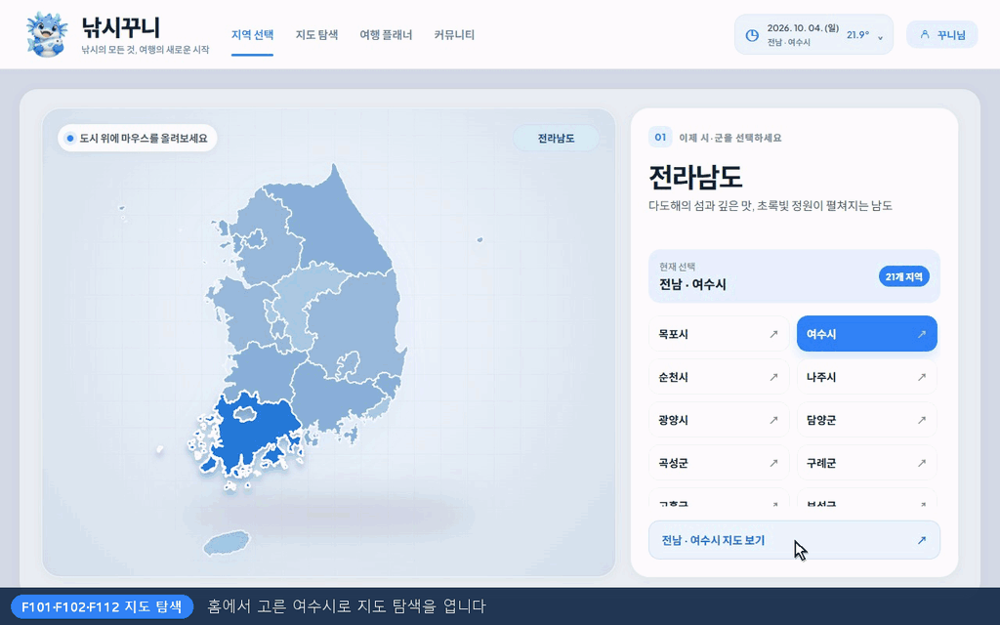

**작업 내용**

- 홈에서 고른 지역을 카카오 주소 검색으로 찾아 지도 중심으로 사용합니다.
- 낚시 포인트·낚시용품점은 키워드 검색, 주변 명소·음식점·숙박은 카테고리 검색으로 현재 지도 범위 안의 장소를 조회합니다. 지도를 움직이면 범위에 맞춰 다시 검색합니다.
- 장소를 누르면 주소·전화·카카오맵 링크를 보여주고, 로그인한 사용자는 관심 장소로 저장해 마이페이지에서 확인합니다.
- **마커 대표 이미지:** 마커를 누르면 지도 정보창에 대표 사진 1장이 장소 이름·카카오맵 링크와 함께 나옵니다. 서버의 `/api/place-photo`가 한국관광공사 국문관광정보서비스에서 좌표 1km 이내이면서 이름이 같은 장소의 `firstimage`를 찾고, 없으면 이름 검색 결과 중 2km 이내의 장소를 찾습니다. `.env`에 `KAKAO_REST_API_KEY`가 있으면 관광공사에 없는 장소는 카카오 이미지 검색 첫 결과를 사용합니다. 사진이 없거나 불러오지 못하면 장소 유형별 기본 이미지를 보여주며, 사진 출처를 정보창에 표시합니다. 사용자가 등록한 마커는 비공개 이름일 수 있어 외부 조회 없이 마커 이미지를 사용합니다.
- 한계: 장소 목록 데이터는 한국관광공사 API가 아니라 카카오 장소 검색 결과입니다(F101·F102 △, F103 ❌). 대표 사진은 관광공사에 등록되지 않은 낚시터·용품점 등에서는 기본 이미지로 표시됩니다.

**관련 Source:** [map.html](map.html) · [js/map.js — 장소 유형 `CATEGORY`](js/map.js#L6), [`searchCategory`](js/map.js#L164), [관심 장소 `favoriteButton`](js/map.js#L222), [대표 이미지 `placePhoto`](js/map.js#L251), [정보창 `selectPlace`](js/map.js#L294), [`initializeMap`](js/map.js#L490) · [server.cjs — `/api/place-photo`](server.cjs#L670), [`getPlacePhoto`](server.cjs#L355), [관광공사 사진 `tourPlacePhoto`](server.cjs#L326), [이름 일치 점수 `placeNameScore`](server.cjs#L304), [카카오 이미지 검색 `kakaoImagePhoto`](server.cjs#L341) · [js/session.js — 지역 좌표 `resolveRegion`](js/session.js#L145), [`loadKakaoMaps`](js/session.js#L96)

**핵심 코드** — 장소 유형과 검색 방식 ([js/map.js](js/map.js#L6))

```javascript
const CATEGORY = {
  point: { label: "낚시 포인트", keyword: "낚시터", icon: "point" },
  store: { label: "낚시용품점", keyword: "낚시용품", icon: "store" },
  attraction: { label: "주변 명소", code: "AT4", icon: "trip" },
  restaurant: { label: "음식점", code: "FD6", icon: "restaurant" },
  lodging: { label: "숙박", code: "AD5", icon: "lodging" },
};
// searchCategory(): 현재 지도 범위 안에서 카테고리 코드 또는 키워드로 조회
const options = { bounds: map.getBounds(), location: map.getCenter(), size: 15 };
if (category.code) places.categorySearch(category.code, callback, options);
else places.keywordSearch(category.keyword, callback, options);
```

### 5. hotplace 마커 등록 (F105)

**화면영상 — 지도 클릭으로 나만의 장소(마커) 등록**

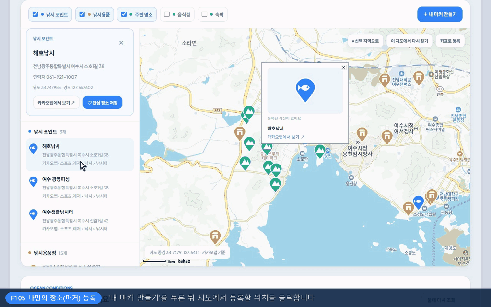

**작업 내용**

- **마커 추가**를 누르고 지도를 클릭하면 위도·경도가 입력됩니다. 이름(60자)·유형(낚시 포인트/용품점)·공개 범위·메모(300자)와 다섯 가지 마커 이미지 중 하나를 선택합니다.
- 로그인한 사용자의 마커는 `kkuni-markers`에 저장되어 새로고침 후에도 복원되고 마이페이지 **내가 등록한 장소**에 표시됩니다. 비회원은 이번 방문 동안만 유지되는 임시 마커를 사용합니다.

**관련 Source:** [map.html — 장소 등록 창](map.html#L129) · [js/map.js — `openMarkerDialog`](js/map.js#L334), [`saveMarker`](js/map.js#L357) · [js/mypage.js — 마커 삭제와 참조 정리](js/mypage.js#L88)

### 6. 해양 정보 — 조석·조위·바다낚시지수

**화면영상 — 해양 정보 · 지도 이동 후 물때 다시 조회**

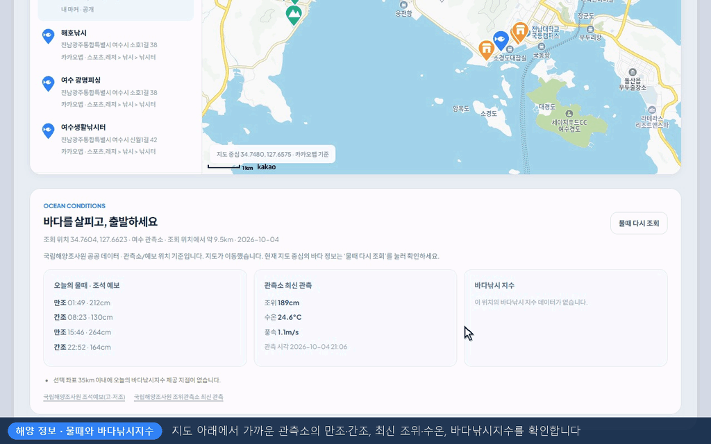

**작업 내용:** 지도 중심에서 35km 이내의 조위관측소와 바다낚시 예보 지점을 골라 만조·간조 시각, 최신 조위·수온·기온·풍속, 낚시지수를 표시합니다. 기준 지점과 거리·시각·출처를 함께 보여주고, 지도를 옮긴 뒤 **물때 다시 조회**로 갱신합니다.

**관련 Source:** [map.html — 해양 정보 영역](map.html#L119) · [js/map.js — `loadMarine`](js/map.js#L458) · [server.cjs — `getMarine`](server.cjs#L375), [`nearestStation`](server.cjs#L294)

### 7. AI 여행 플래너 (F104)

**화면영상 — 출발·도착 선택 → 날짜·취향 → AI 추천 3개 → 지도 미리보기 → 저장**

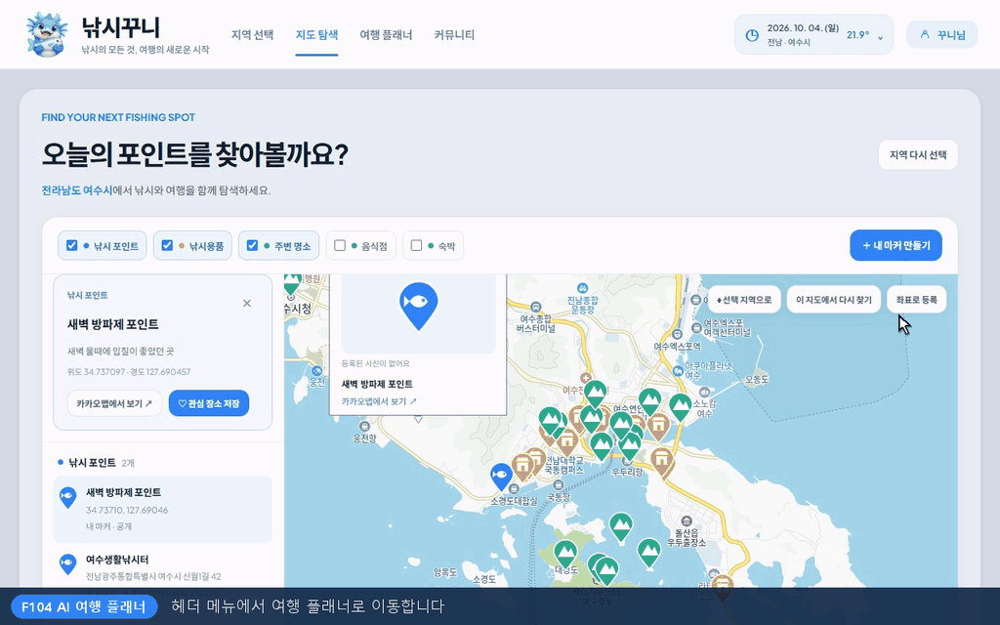

**화면영상 — 저장한 여행 상세 · 전체/장소별 메모 저장**

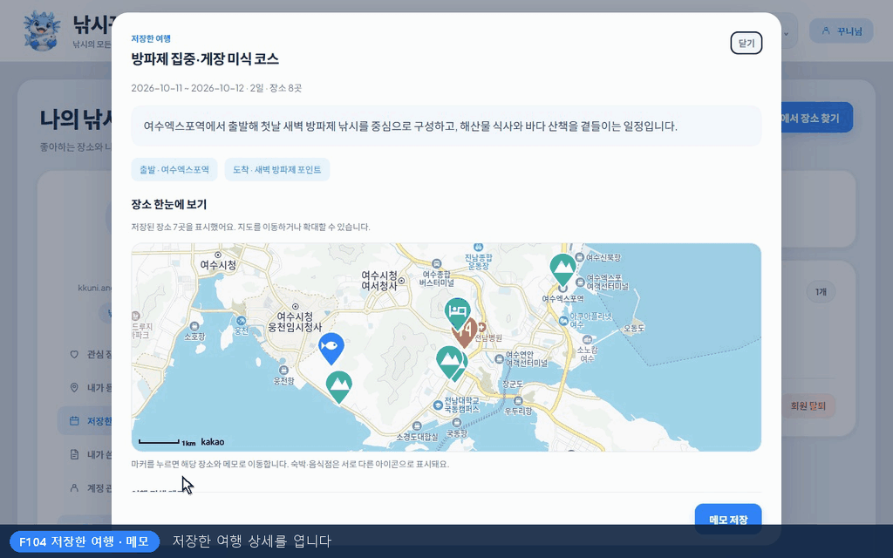

**작업 내용**

- 지도 클릭, 장소 검색, 주변 낚시터, 내 낚시 포인트로 출발지와 도착지를 고르고 여행 날짜(최대 7일)와 취향을 입력합니다.
- 경로 중간 지점과 도착지 주변의 숙박·음식점·명소 후보를 카카오에서 모아 서버의 `/api/travel-plans`로 보내고, 서버가 OpenAI 응답을 검증해 서로 다른 일정 3개를 돌려줍니다.
- 선택한 일정은 로그인 후 `kkuni-trips`에 저장하고, 마이페이지에서 일정 지도와 여행 전체 메모(10,000자)·장소별 메모(2,000자)를 관리합니다.

**관련 Source:** [travel.html](travel.html) · [js/travel.js — `collectCandidates`](js/travel.js#L270), [`validatePlans`](js/travel.js#L293), [`savePlan`](js/travel.js#L333), [`generatePlans`](js/travel.js#L442) · [server.cjs — `getTravelPlans`](server.cjs#L538) · [js/mypage.js — `openTrip`](js/mypage.js#L525), [메모 저장](js/mypage.js#L579)

**핵심 코드** — 실제 장소 후보로 AI 일정 요청 ([js/travel.js](js/travel.js#L457))

```javascript
request.candidates = await collectCandidates(request, controller.signal);
const response = await fetch("/api/travel-plans", {
  method: "POST", headers: { "Content-Type": "application/json" },
  body: JSON.stringify(request), signal: controller.signal,
});
const data = await response.json();
if (!response.ok) throw new Error(data.message || "AI 여행 추천에 실패했습니다. (HTTP " + response.status + ")");
plans = validatePlans(data, request); // 요청한 날짜와 후보 ID 안의 장소만 허용
```

### 8. 커뮤니티 — 공유게시판 CRUD (F110)

**화면영상 — 글 작성(사진 첨부) → 상세 → 수정 → 삭제**

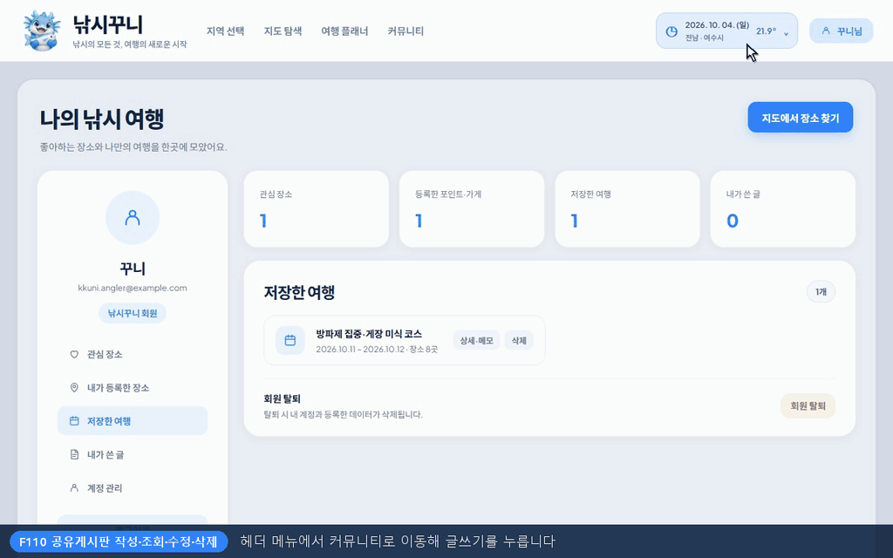

**작업 내용**

- **목록:** 여행 이야기·숨은 장소·질문·답변·자유 토론 카테고리로 거르고, 첫 사진을 카드 썸네일로 보여줍니다.
- **등록:** 로그인한 사용자가 카테고리·제목(2~80자)·본문(10~3,000자)과 사진(최대 4장)을 입력합니다. 사진은 브라우저에서 크기를 줄여 IndexedDB에 저장하고 글에는 사진 ID만 남깁니다.
- **상세:** 사진 갤러리와 본문을 보여주고 좋아요 수를 표시합니다. `community.html?post=ID`로 바로 열 수 있습니다.
- **수정·삭제:** 작성자에게만 버튼이 보이며, 삭제할 때 첨부 사진도 함께 지웁니다.

**관련 Source:** [community.html — 글 목록](community.html#L89), [작성·수정 창](community.html#L207) · [js/community.js — `render`](js/community.js#L253), [`openDetail`](js/community.js#L328), [삭제](js/community.js#L355), [`openEditor`](js/community.js#L494), [저장(등록·수정)](js/community.js#L570), [사진 변환 `resizeImage`](js/community.js#L95)

**핵심 코드** — 등록과 수정 ([js/community.js](js/community.js#L602))

```javascript
const posts = readList(KEYS.posts);
const now = new Date().toISOString();
if (editingPost) {
  const post = posts.find((item) => item.id === editingPost.id);
  if (!post || post.ownerEmail !== user.email) throw new Error("수정할 수 있는 글이 아닙니다.");
  Object.assign(post, { category, title, body, images: imageMeta, updatedAt: now });
} else {
  posts.push({
    id: createId(), ownerEmail: user.email, author: user.name,
    category, title, body, images: imageMeta, likes: 0, createdAt: now, updatedAt: now,
  });
}
writeList(KEYS.posts, posts);
```

### 9. 마이페이지

**화면영상 — 관심 장소 · 등록 장소 · 저장 여행 · 내가 쓴 글 · 계정 관리 탭**

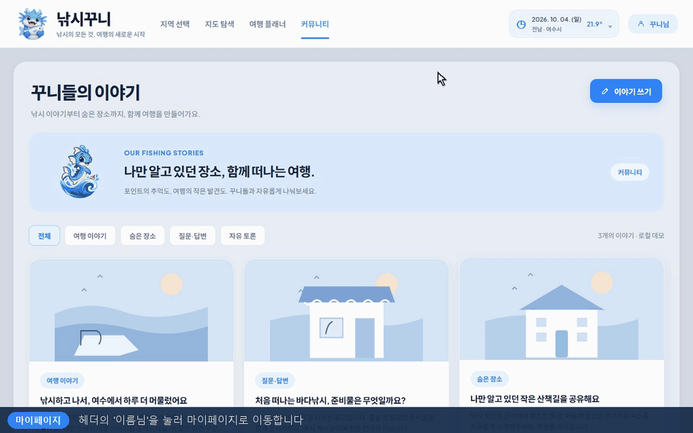

**작업 내용:** 로그인한 사용자의 이메일로 관심 장소·등록 장소·저장 여행·내가 쓴 글을 모아 탭별로 보여주고 삭제·수정 링크를 제공합니다. 등록 장소를 지우면 모든 사용자의 관심 장소와 여행 일정에서 같은 장소를 제거합니다. 로그인 전에는 가상 예시로 화면 구성을 보여줍니다. `mypage.html?tab=favorites|markers|trips|posts|account`로 처음 열 탭을 정할 수 있습니다.

**관련 Source:** [mypage.html](mypage.html) · [js/mypage.js — `userData`](js/mypage.js#L160), [`itemsFor`](js/mypage.js#L170), [`render`](js/mypage.js#L278), [`removeMarkerReferences`](js/mypage.js#L88)

## 페이지 구성

| 담당 화면    | HTML             | JS                | 현재 기능                                                                                                                       |
| ------------ | ---------------- | ----------------- | ------------------------------------------------------------------------------------------------------------------------------- |
| 지역 선택 홈 | `index.html`     | `js/main.js`      | 전국 17개 시도 지도, 시·군 선택, 선택 상태 저장·복원, 오늘 날짜·현재 날씨·시간별 예보                                           |
| 지도 탐색    | `map.html`       | `js/map.js`       | 선택 지역 카카오맵, 낚시 포인트·용품점 검색, 주변 명소·음식점·숙박 필터, 이미지 선택 마커 등록                                  |
| 여행 플래너  | `travel.html`    | `js/travel.js`    | 지도 출발·도착 선택, 실제 장소로 AI 추천 3개, 여행 선택·저장                                                                    |
| 커뮤니티     | `community.html` | `js/community.js` | 카테고리 필터, 게시글 작성·상세·수정·삭제 (작성자만 수정·삭제)                                                                  |
| 로그인       | `login.html`     | `js/login.js`     | 회원가입 창, 로컬 회원 저장, 로그인, 데모 계정, 비밀번호 찾기                                                                   |
| 마이페이지   | `mypage.html`    | `js/mypage.js`    | 관심 장소·등록 장소·저장 여행·내가 쓴 글 목록, 여행 상세 지도·전체/장소 메모, 계정 정보·회원정보 수정, 로그아웃, 회원 탈퇴      |

모든 페이지는 공통 `js/session.js`와 헤더 날짜·날씨 버튼을 담당하는 `js/main.js`를 먼저 불러온 뒤 자기 JS 파일을 불러옵니다. `main.js`의 지역 선택 지도 기능은 홈에서만 동작하고, 다른 페이지에서는 홈에서 저장한 선택 지역으로 날씨를 조회합니다. `session.js`는 로그인 상태 읽기·변경, 로그아웃, localStorage 목록 읽기·쓰기, 비밀번호 해시를 `window.Kkuni`로 제공하고, 로그인한 경우 헤더의 로그인 버튼을 `이름님` 마이페이지 링크로 바꿉니다. 헤더의 `<span class="login-link-text">`가 이 텍스트 자리입니다. 담당자는 해당 HTML에서 화면 구조를, 해당 JS에서 이벤트와 기능을 수정하면 됩니다. 메뉴는 일반 링크로 각 HTML 페이지에 이동합니다. 헤더는 각 HTML에 포함되어 있으며, 현재 메뉴의 `active` 클래스와 `aria-current="page"`도 HTML에서 지정합니다.

공통 스타일은 `css/main.css`, 헤더 로고는 `img/icons/03-낚시꾸니.png`입니다. 지역 선택의 시·군 버튼은 `index.html`의 `<template>`을 복제한 뒤 텍스트와 이벤트를 연결합니다. JS에는 HTML 문자열이나 `innerHTML`을 사용하지 않습니다.

원본의 Python 서버, 데이터, 채팅·업로드 화면과 코드는 포함하지 않았습니다. 지도 경계 데이터의 원본은 [korea-maps](https://github.com/swcho/korea-maps)입니다.

## 실행

지역 선택과 커뮤니티 같은 정적 화면은 HTML을 직접 열거나 정적 파일 서버로 이 폴더를 실행해 확인할 수 있습니다.

카카오맵, 날씨·물때와 AI 여행 추천을 사용하려면 Node.js 20.12 이상에서 프로젝트 폴더의 서버를 실행합니다.

```bash
node server.cjs
```

접속 주소는 서버 시작 로그를 따릅니다. `.env`에 `PORT=5500`을 설정하면 `http://127.0.0.1:5500`에서 홈을, `/map.html`에서 지도를 확인할 수 있습니다. `PORT`를 지정하지 않으면 코드의 기본 포트는 **4173**입니다. 서버는 같은 폴더의 `.env`를 자동으로 읽습니다. `KAKAO_MAP_KEY`는 카카오맵 JavaScript 키, `DATA_GO_KR_KEY`는 공공데이터 API의 공통 인증키입니다. `.env`에는 각 API의 기본 엔드포인트와 서버 `PORT`도 저장합니다. 기존 개발 환경은 `http://127.0.0.1:5500`을 사용했습니다. 카카오 콘솔의 현재 허용 주소는 실행 전에 확인해야 합니다. 다른 호스트나 포트를 사용하려면 카카오 개발자 콘솔에도 해당 웹사이트 주소를 등록해야 합니다. 공공데이터 인증키는 서버에서 사용하고, 브라우저에는 카카오맵 SDK에 필요한 키만 전달합니다. `.env`를 변경하면 서버를 다시 실행합니다. `.env`는 Git 추적에서 제외됩니다.

## 날짜·날씨와 지도 탐색

홈에서 시도와 시·군·구를 선택하면 우측 상단의 날짜·날씨 버튼이 해당 지역으로 바뀝니다. 버튼을 누르면 한국 시간 기준 오늘의 시간별 기온, 하늘 상태, 강수, 습도, 풍속을 확인할 수 있습니다. 날씨는 기상청 초단기실황과 단기예보를 사용하며, 제공되지 않은 시간이나 항목은 미제공 상태로 표시합니다. 조회 중 지역을 바꾸면 마지막으로 선택한 지역의 결과만 반영합니다.

날씨 창은 천문연구원의 일출·일몰·월출·월몰·음력 정보와 기상청의 최신 전국 기상특보 현황도 함께 표시합니다. 특보는 `getPwnStatus`로 조회해 전날 발표된 최신 특보·예비특보·참고사항과 발표/현황 기준시각을 보여줍니다. 특보 없음, 자료 없음, 조회 실패를 구분하고 전국 범위를 명시합니다. 이전의 오늘 발표 목록은 발표가 없는 날 코드 `03`을 반환해 현황을 보여주지 못했습니다. [기상청 서비스 명세](https://www.data.go.kr/data/15000415/openapi.do) 지도 아래에는 국립해양조사원의 조석예보·최신 조위관측·바다낚시지수를 표시합니다. 지도에서 조회한 좌표 35km 이내의 기준 관측소와 낚시 예보 지점을 사용하며 거리·기준 시각·출처를 함께 표시합니다. 지도 이동 후에는 물때 다시 조회 버튼으로 현재 지도 중심의 정보를 갱신합니다. 제공기관에서 받지 못한 항목은 빈 상태로 표시합니다.

지도 탐색은 홈의 선택 지역을 카카오 주소 검색으로 찾아 중심 좌표로 사용합니다. 낚시 포인트와 용품점은 카카오 장소 검색 결과이며, 명소·음식점·숙박 토글로 현재 지도 주변의 장소를 함께 볼 수 있습니다. 지도 위치를 이동하면 검색 범위도 바뀝니다. 검색 결과는 실제 낚시 허용 여부를 판정하는 자료가 아닙니다.

마커 추가를 누르고 지도에서 위치를 찍으면 위도·경도가 입력됩니다. 이름과 장소 유형을 지정하고 물고기·낚시용품·여행·숙소·음식점의 다섯 가지 마커 이미지 중 하나를 선택할 수 있습니다. 로그인한 사용자의 마커는 기존 `kkuni-markers` 형식으로 브라우저에 저장해 새로고침 후에도 복원하고 마이페이지에 표시합니다. 비회원은 임시 마커를 사용할 수 있습니다. 카카오 검색 결과의 숙소·음식점에도 전용 마커 이미지를 사용합니다.

## AI 여행 플래너와 여행 메모

`travel.html`에서 지도 클릭, 카카오 장소 검색, 주변 낚시터 검색 또는 내 낚시 포인트로 출발지·도착지를 고릅니다. 각각 실제 카카오 마커를 표시하고 여행 날짜(최대 7일)와 취향을 받아 경로 중간 지점·도착지 주변의 숙박·음식점·관광명소 후보를 조회합니다. 지도 점선은 두 좌표의 연결선이며 실제 도로 경로는 카카오 길찾기에서 확인합니다.

`POST /api/travel-plans`는 서버에서 [`gpt-5.6-luna`](https://developers.openai.com/api/docs/models/gpt-5.6-luna) Responses API를 호출합니다. 프로젝트 `.env`의 `OPENAI_API_KEY` 또는 기존 `OPEN_API_KEY`만 사용합니다. 해당 파일에 키가 없으면 설정 오류를 표시하며 실행 환경이나 다른 프로젝트의 키는 사용하지 않습니다. OpenAI 키는 브라우저에 전달하지 않습니다. 조회한 카카오 후보만 모델에 전달하고 [Structured Outputs](https://developers.openai.com/api/docs/guides/structured-outputs) 및 서버 검증으로 요청한 날짜와 실제 후보 안의 장소를 사용하는 서로 다른 조합 3개만 표시합니다. 각 조합은 출발지·도착지·숙소·음식점·명소를 포함합니다. API 연결·결제·응답 오류는 안내하며 임의 추천으로 대체하지 않습니다.

추천은 로그인 없이 볼 수 있고 선택한 플랜은 로그인 후 기존 `kkuni-trips`에 저장합니다. 로그인 이동 중에도 추천을 유지합니다. 마이페이지의 저장한 여행에서 상세 일정과 카카오 마커를 확인하고 여행 전체 메모(10,000자) 및 장소별 메모(2,000자)를 저장할 수 있습니다. 동일 장소는 날짜가 달라도 여행 내 메모를 공유합니다. 메모는 현재 계정의 여행에만 저장되며 새로고침 후에도 유지됩니다. `mypage.html?tab=trips&trip=ID`로 내 여행 상세를 바로 열 수 있습니다.

## 로컬 회원 저장

회원가입하면 `localStorage`의 `kkuni-users` 키에 회원 배열을 JSON 문자열로 저장합니다. 계정은 새로고침 후에도 유지되며, 로그인 시 저장된 목록을 다시 읽습니다. 선택한 저장 방식은 브라우저 저장소이므로 `json/user.json` 파일에는 쓰지 않습니다.

회원 정보는 `name`, `email`, `salt`, `passwordHash`, `iterations`, `createdAt`으로 구성되며, 회원정보 수정이나 비밀번호 찾기로 바뀐 계정에는 `updatedAt`이 추가됩니다. 비밀번호 원문은 저장하지 않고 사용자별 salt와 PBKDF2 해시를 보관합니다. 비밀번호를 바꿀 때마다 salt도 새로 만듭니다. 로그인한 사용자의 이름과 이메일은 `sessionStorage`의 `kkuni-current-user` 키에 저장합니다.

개발자 도구의 **Application → Local Storage**에서 `kkuni-users`를 확인하거나, Console에서 다음 코드로 읽을 수 있습니다.

```javascript
JSON.parse(localStorage.getItem('kkuni-users'));
```

데모 계정 버튼을 처음 누르면 `demo@example.com` / `demo1234!` 계정을 생성합니다. 이후에는 같은 계정을 사용합니다.

같은 브라우저와 같은 사이트 주소에서 실행해야 같은 저장소를 사용합니다. `file:` 주소의 저장소 동작은 브라우저마다 다를 수 있으므로 개발 시에는 Live Server 같은 정적 파일 서버로 실행하면 주소를 일정하게 유지하기 쉽습니다. [localStorage 동작 문서](https://developer.mozilla.org/en-US/docs/Web/API/Window/localStorage)

이 로그인은 브라우저 저장소로 동작을 연습하는 기능입니다. 실제 서비스의 계정 검증과 접근 권한은 서버에서 처리해야 합니다.

커뮤니티는 주소로 글을 바로 열 수 있습니다. `community.html?post=ID`는 상세, `community.html?edit=ID`는 수정 창(작성자만)을 엽니다. `&from=mypage`를 붙이면 저장하거나 취소한 뒤 `mypage.html?tab=posts`로 돌아갑니다. 마이페이지는 `?tab=favorites|markers|trips|posts|account`로 처음 열 탭을 정할 수 있습니다.

로그인 화면은 `login.html?next=community.html`처럼 `next`가 있으면 로그인 후 해당 페이지로 돌아갑니다. 같은 폴더의 `*.html` 이름만 허용합니다.

## 브라우저 저장 데이터

모든 목록은 localStorage에 JSON 배열로 저장하며, 소유자는 이메일로 구분합니다. 지도 탐색과 여행 플래너를 구현할 때 아래 형식에 맞춰 저장하면 마이페이지에 바로 표시됩니다.

| 키                | 항목 형식                                                                                                                                                          | 작성 화면              |
| ----------------- | ------------------------------------------------------------------------------------------------------------------------------------------------------------------ | ---------------------- |
| `kkuni-users`     | `{ name, email, salt, passwordHash, iterations, createdAt, updatedAt? }`                                                                                           | 로그인·마이페이지      |
| `kkuni-posts`     | `{ id, ownerEmail, author, category(story·hidden·qna·free), title, body, images: [{ id, width, height }], likes, createdAt, updatedAt }`                           | 커뮤니티               |
| `kkuni-favorites` | `{ userEmail, place: { id, name, category, sample? } }`                                                                                                            | 지도 탐색              |
| `kkuni-markers`   | `{ id, ownerEmail, category(point·store), name, lat, lng, address, desc, visibility(public·private), icon, createdAt }`                                            | 지도 탐색              |
| `kkuni-trips`     | `{ id, ownerEmail, name, start, end, origin, destination, summary, days: [{ date, places: [{ id, ... }] }], tips, model, memo, placeNotes, createdAt, updatedAt }` | 여행 플래너·마이페이지 |

게시글 사진은 용량 때문에 localStorage가 아니라 IndexedDB `kkuni-images`(store `images`)에 `{ id, full, thumb, width, height }` Blob으로 저장하고, 글에는 사진 `id`만 남깁니다. 첨부할 때 브라우저에서 자동으로 크기를 맞춥니다.

- `full`: 비율을 유지한 채 긴 변을 1600px 이하로 줄인 JPEG. 상세 화면에서 창 폭과 높이(최대 520px) 안에 잘림 없이 표시합니다.
- `thumb`: 가운데를 2:1로 잘라 640×320으로 만든 JPEG. 카드 썸네일 칸도 2:1이라 추가로 잘리거나 여백이 생기지 않습니다. 비율을 바꾸려면 `js/community.js`의 `THUMB_WIDTH`/`THUMB_HEIGHT`와 `css/community.css`의 `.post-thumb` `aspect-ratio`를 함께 바꿉니다.
- 글당 최대 4장, 원본 20MB 이하, JPG·PNG·WebP·GIF·AVIF를 받습니다. 휴대폰 사진의 회전 정보를 반영하고, 투명 배경은 흰색으로 채웁니다. GIF 애니메이션은 첫 장면만 저장됩니다.

장소 `category`는 `point`, `store`, `attraction`, `restaurant`, `lodging`, `festival` 중 하나입니다. 마이페이지에서 등록 장소를 삭제하면 모든 사용자의 관심 장소와 여행 일정에서 같은 `id`의 장소도 제거됩니다. 회원 탈퇴는 확인 문구 `탈퇴`와 현재 비밀번호를 확인한 뒤 계정과 본인 소유의 위 데이터를 모두 지우고 로그아웃합니다.

## 로그인 검증

프로젝트 폴더에서 `node --test`를 실행합니다. 브라우저 DOM과 저장소 경계를 재현하고 실제 Web Crypto를 사용해 저장 후 재접속, 중복 가입, 틀린 비밀번호, 저장 오류, 비밀번호 찾기와 데모 로그인을 검사합니다.

```bash
node --test
```

## 공공 데이터 활용 명세

아래 출처는 `server.cjs`에 지정된 제공기관 링크입니다. 프런트엔드는 동일 출처의 `/api/weather`, `/api/marine`, `/api/place-photo`를 호출하며, 서버가 인증키를 붙여 외부 API를 요청하고 화면용 JSON으로 정리합니다.

| 제공 기관 / 데이터                                                              | 호출 작업                          | 사용 데이터                                                                                                                  | 활용 화면과 목적                                                     |
| ------------------------------------------------------------------------------- | ---------------------------------- | ---------------------------------------------------------------------------------------------------------------------------- | -------------------------------------------------------------------- |
| 기상청 [단기예보·초단기실황](https://www.data.go.kr/data/15084084/openapi.do)   | `getUltraSrtNcst`, `getVilageFcst` | 실황 `T1H` 기온, `REH` 습도, `WSD` 풍속, `RN1` 강수량, `PTY` 강수형태 / 예보 `TMP`, `SKY`, `PTY`, `POP`, `PCP`, `REH`, `WSD` | 홈의 현재 날씨와 오늘 시간별 예보. 낚시 여행 전 기상 조건 확인       |
| 기상청 [기상특보 현황](https://www.data.go.kr/data/15000415/openapi.do)         | `getPwnStatus`                     | `tmFc` 발표시각, `tmEf` 현황 기준시각, `t6` 특보, `t7` 예비특보, `other` 참고사항                                            | 홈 날씨 창의 최신 전국 특보 안내. 선택 지역만의 특보로 표시하지 않음 |
| 한국관광공사 [국문관광정보서비스_GW](https://www.data.go.kr/data/15101578/openapi.do) | `locationBasedList2`, `searchKeyword2` | `title` 장소명, `firstimage` 대표 이미지, `mapx` 경도, `mapy` 위도                                                          | 지도 마커 정보창의 대표 사진. 좌표·이름이 일치하는 장소만 사용       |
| 국립해양조사원 [조석예보](https://www.data.go.kr/data/15156018/openapi.do)      | `GetTideFcstHghLwApiService`       | `predcDt` 예측시각, `predcTdlvVl` 조위, `extrSe` 고·저조 구분                                                                | 지도 아래 만조·간조 시각과 높이 표시                                 |
| 국립해양조사원 [최신 조위관측](https://www.data.go.kr/data/15155508/openapi.do) | `GetDTRecentApiService`            | `obsrvnDt` 관측시각, `bscTdlvHgt` 조위, `wtem` 수온, `artmp` 기온, `wspd` 풍속, `wndrct` 풍향                                | 지도 아래 기준 관측소의 최신 해양 관측 정보                          |
| 국립해양조사원 [바다낚시지수](https://www.data.go.kr/data/15142486/openapi.do)  | `GetFcstFishingApiServicev2`       | 지점명·위경도, 예보 날짜·오전/오후·어종, `lastScr` 지수, `totalIndex` 등급, 수온·파고·풍속 최솟값/최댓값, 물때 정보          | 지도 주변 갯바위 낚시 예보 지점의 지수와 환경 범위 확인              |
| 한국천문연구원 [출몰시각](https://www.data.go.kr/data/15012688/openapi.do)      | `getLCRiseSetInfo`                 | `sunrise`, `sunset`, `moonrise`, `moonset`, `location`                                                                       | 홈 날씨 창에서 해와 달이 뜨고 지는 시각 확인                         |
| 한국천문연구원 [음양력](https://www.data.go.kr/data/15012679/openapi.do)        | `getLunCalInfo`                    | `lunYear`, `lunMonth`, `lunDay`, `lunLeapmonth`                                                                              | 홈 날씨 창에 음력 날짜와 윤달 표시                                   |

### 데이터 처리 방식

1. **지역과 좌표:** 홈의 시도·시군구 선택을 `sessionStorage`에 저장하고, 공통 지역 처리 코드가 카카오 주소 검색으로 좌표를 구합니다. 날씨 서버는 위경도를 기상청의 5km 격자 `nx`, `ny`로 변환합니다.
2. **날씨 시간 기준:** 한국 시간 기준으로 조회 날짜와 발표시각을 계산합니다. 전날 23시 예보와 최신 예보를 합치고, 같은 시간은 최신 발표 값으로 교체합니다. 과거 시간에 표시하는 값도 예보이며 과거 실측값으로 바꾸지 않습니다. 자료 없음 코드 `03`이면 최신 예보를 한 발표 주기 이전으로 재조회합니다.
3. **해양 기준 지점:** 서버에 등록된 조위관측소 중 좌표와 가장 가까운 곳을 찾고 **35km 이내**일 때만 사용합니다. 바다낚시지수는 전국 데이터 첫 두 페이지를 조회한 뒤 오늘 날짜를 추리고, 35km 이내의 가장 가까운 예보 지점을 선택합니다. 관측소명·거리·시각을 표시해 클릭 좌표의 직접 측정값과 구분합니다.
4. **형식 정리:** JSON의 항목 배열과 천문 API의 XML 값을 읽어 화면용 필드로 변환합니다. 빈 값·유효하지 않은 수치는 `null`로 처리합니다. 만조·간조는 제공기관의 구분 코드로 분류하고, 낚시 예보 환경값은 최솟값/최댓값 범위로 유지합니다.
5. **캐시와 부분 실패:** 서버 메모리에 요청별 Promise를 보관해 중복 호출을 줄입니다. 특보 1분, 일반 조회 5분, 단기예보 10분, 조석·낚시지수 30분, 천문 정보 6시간의 TTL을 사용합니다. 실패한 요청은 캐시에서 제거합니다. 여러 데이터 중 일부가 실패하면 받은 자료와 안내 문구를 함께 반환합니다.
6. **미제공 처리:** 누락 시간이나 수치를 임의로 만들지 않습니다. 특보 없음·자료 없음·조회 실패를 구분하며, 수온과 염분이 모두 0인 관측 응답에는 유효성 확인 안내를 덧붙입니다.
7. **대표 사진 매칭:** 장소 이름에서 괄호·공백·기호를 지운 뒤 같은 이름이면 1점, 한쪽 이름이 다른 쪽에 포함되면 겹치는 길이 비율로 점수를 매겨 0.6 이상인 장소 중 가장 높은 곳의 사진을 사용합니다. 좌표 1km 이내 검색을 먼저 하고, 없으면 이름 검색 결과 중 2km 이내만 사용합니다. 관광공사 응답의 `http` 이미지 주소는 `https`로 바꾸고, 결과는 날씨 캐시와 분리된 저장소에 24시간 보관합니다.

### 다른 외부 데이터와 자체 데이터

| 구분                            | 출처 / 저장소                                              | 역할                                                                                                                           |
| ------------------------------- | ---------------------------------------------------------- | ------------------------------------------------------------------------------------------------------------------------------ |
| 지도·주소·장소                  | 카카오 Maps JavaScript SDK의 지도, Geocoder, Places        | 지역 좌표, 낚시 관련 키워드 검색, 관광명소·음식점·숙박 검색, 장소 이름·주소·위경도·상세 링크                                   |
| 대표 사진 보조 (선택)           | 카카오 이미지 검색 API (`KAKAO_REST_API_KEY` 설정 시)      | 관광공사에 사진이 없는 장소의 정보창 사진. 웹 검색 결과이므로 출처 사이트명을 함께 표시                                       |
| 전국 지역 지도                  | [korea-maps](https://github.com/swcho/korea-maps) 기반 SVG | 홈의 17개 시도 선택. HTML에 포함된 지도와 지역 목록을 사용                                                                     |
| AI 생성 일정                    | 서버의 OpenAI Responses API 호출                           | 브라우저에서 검색한 장소 후보와 여행 조건을 받아 3개 일정 조합 생성. 공공 데이터 자체가 아니며 서버가 후보 ID·날짜·조합을 검증 |
| 회원·관심 장소·마커·여행·게시글 | localStorage / sessionStorage / IndexedDB                  | 사용자가 입력하거나 저장한 브라우저별 데이터. 공공 데이터 또는 중앙 서버 DB가 아님                                             |

카카오 검색 결과는 낚시 허용 여부의 근거가 아니며, 여행 지도 연결선은 도로 경로 계산 결과가 아닙니다. AI 후보는 브라우저에서 전달받으므로 서버 검증은 형식·좌표·후보 ID의 일관성을 확인하는 범위이고, 카카오 원본을 서버가 다시 조회해 진위를 보증하는 구조는 아닙니다.

## 상세 기능 명세서

| 페이지 / 기능              | 입력·조건                                     | 처리                                                       | 결과·예외 처리                                                             |
| -------------------------- | --------------------------------------------- | ---------------------------------------------------------- | -------------------------------------------------------------------------- |
| 홈 / 지역 선택             | 시도와 시군구 선택                            | SVG 선택 상태·지역 버튼 갱신, 지역 세션 저장               | 선택 상태 복원, 지도 탐색 지역과 날씨 조회 지역 공유                       |
| 홈 / 날씨                  | 선택 지역, 날씨 버튼                          | 좌표 조회 후 `/api/weather` 호출                           | 실황·시간별 예보·천문·특보 표시. 로딩·부분 누락·오류·재조회 안내           |
| 지도 / 장소 탐색           | 선택 지역, 지도 이동, 유형 필터               | 카카오 키워드·카테고리 검색, 지도 범위 내 마커 표시        | 장소 목록·상세·외부 링크. 검색 오류·빈 결과 안내                           |
| 지도 / 대표 사진           | 마커 클릭(장소명·좌표·주소)                   | `/api/place-photo`로 관광공사 사진 조회, 선택 시 카카오 이미지 검색 | 정보창에 사진 1장과 출처 표시. 사진 없음·로딩 실패 시 유형별 기본 이미지     |
| 공통 / 헤더 날씨           | 모든 페이지의 날짜·날씨 버튼                  | 홈에서 저장한 선택 지역으로 `/api/weather` 호출            | 6개 페이지에서 같은 위치·크기의 버튼과 같은 날씨 창. 지역 미선택 시 선택 안내 |
| 지도 / 관심 장소           | 로그인 상태, 선택 장소                        | 현재 이메일과 장소 정보를 저장                             | 관심 등록·해제, 마이페이지 목록 연동. 비회원은 로그인 안내                 |
| 지도 / 마커 등록           | 좌표, 이름, 유형, 공개 범위, 설명, 아이콘     | 폼 검증 후 마커 생성                                       | 회원은 저장·복원, 비회원은 임시 사용                                       |
| 지도 / 해양 정보           | 지도 중심, 물때 다시 조회                     | `/api/marine`에서 관측소·예보 지점 조회                    | 조석·관측·낚시지수와 기준 지점 표시. 35km 내 지점 없음·부분 실패 안내      |
| 플래너 / 지점 선택         | 지도 클릭, 장소 검색, 내 낚시 포인트          | 출발지·도착지 좌표와 마커 갱신                             | 지도 미리보기와 카카오 길찾기 링크                                         |
| 플래너 / AI 추천           | 출발·도착, 시작·종료일, 취향                  | 최대 7일 검증, 장소 후보 수집, `/api/travel-plans` 호출    | 서로 다른 일정 3개. 후보 부족·키 설정·API 한도·응답 오류 안내, 생성 취소   |
| 플래너 / 여행 저장         | 추천 선택, 로그인                             | 이메일 소유자로 `kkuni-trips` 저장                         | 마이페이지에서 확인. 비회원은 추천 임시 보관 후 로그인으로 이동            |
| 커뮤니티 / 열람            | 카테고리, 게시글 선택                         | 저장 글 목록 필터, 상세 창 표시                            | 사진·본문 표시, 좋아요 수 증가. 빈 목록 안내                               |
| 커뮤니티 / 작성·편집       | 로그인, 제목·본문·카테고리·사진               | 입력 검증, 사진 변환 후 IndexedDB 저장, 글 목록 저장       | 작성 완료. 작성자만 수정·삭제. 이미지·저장 실패 안내                       |
| 로그인 / 회원가입          | 이름, 이메일, 비밀번호 및 확인                | 입력·중복 검증, salt 생성, PBKDF2-SHA256 600,000회 해시    | 로컬 회원 생성. 취소·중복·손상 데이터·저장 실패 처리                       |
| 로그인 / 로그인            | 이메일·비밀번호 또는 데모 계정                | 저장된 회원 해시 대조, 사용자 세션 저장                    | 허용된 `next` 페이지로 복귀. 인증 실패 안내                                |
| 로그인 / 비밀번호 찾기     | 가입 이메일, 가입 이름, 새 비밀번호 및 확인   | 이메일·이름 일치 확인, 새 salt와 해시 생성 후 회원 목록 갱신 | 로그인 창에 이메일 입력 후 재로그인 안내. 불일치·비밀번호 확인 불일치 시 변경하지 않음 |
| 마이페이지 / 내 데이터     | 로그인, 탭 선택                               | 이메일별 관심·등록 장소·여행·글 조회                       | 목록·삭제·게시글 편집 링크. 비회원은 로그인 안내, 빈 목록 표시             |
| 마이페이지 / 회원정보 수정 | 닉네임, 새 비밀번호(선택) 및 확인, 현재 비밀번호 | 현재 비밀번호 검증, 닉네임·해시 갱신, 내 글 작성자명·세션·헤더 갱신 | 변경 내용 없음·8자 미만·확인 불일치·현재 비밀번호 오류 안내. 이메일은 변경 불가 |
| 마이페이지 / 여행 메모     | 내 여행, 전체·장소별 메모                     | 소유자 확인, 길이 검증, 여행 데이터 갱신                   | 전체 10,000자·장소별 2,000자까지 저장·복원. 지도 로딩 실패 시 재시도       |
| 마이페이지 / 로그아웃      | 로그아웃 버튼, 확인                           | 세션의 현재 사용자 제거                                    | 홈으로 이동, 헤더가 `로그인`으로 돌아감                                    |
| 마이페이지 / 탈퇴          | 확인 문구 `탈퇴`, 현재 비밀번호               | 비밀번호 검증 후 계정과 소유 데이터 삭제                   | 로그아웃. 확인 실패 시 삭제하지 않음                                       |

## 페이지 구성과 흐름도

각 페이지는 독립 HTML이며 공통 헤더 링크로 이동합니다. 아래 도식의 저장소는 모두 해당 브라우저의 저장소를 뜻합니다.

### 전체 이동 흐름

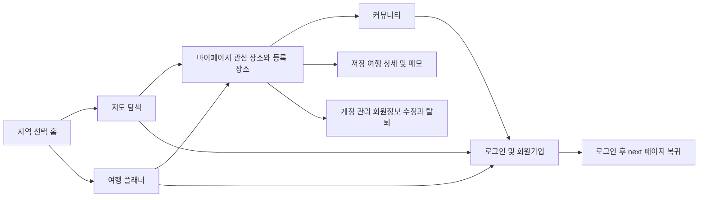

### 홈 — index.html

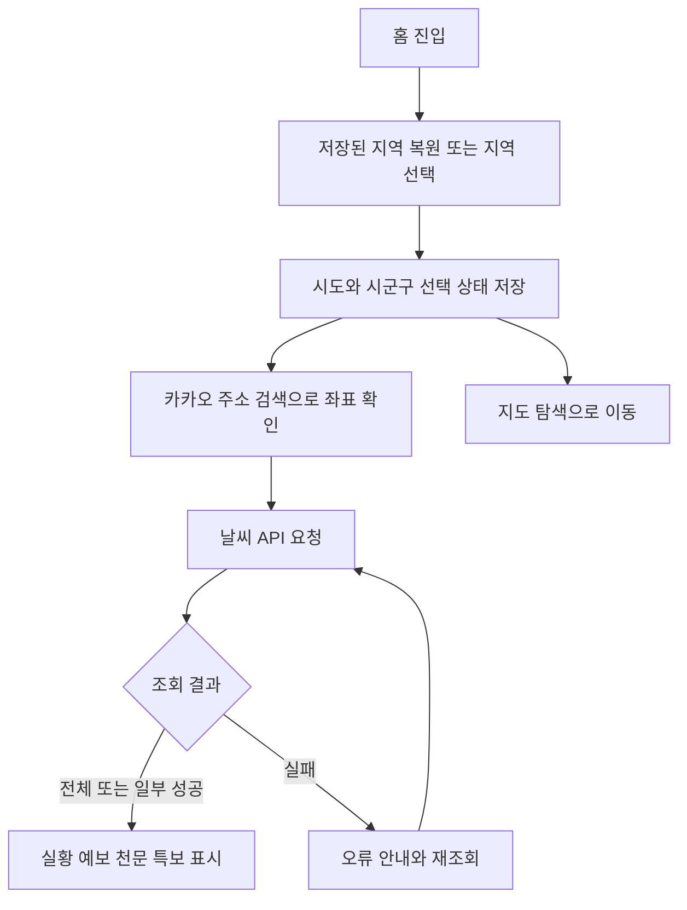

### 지도 탐색 — map.html

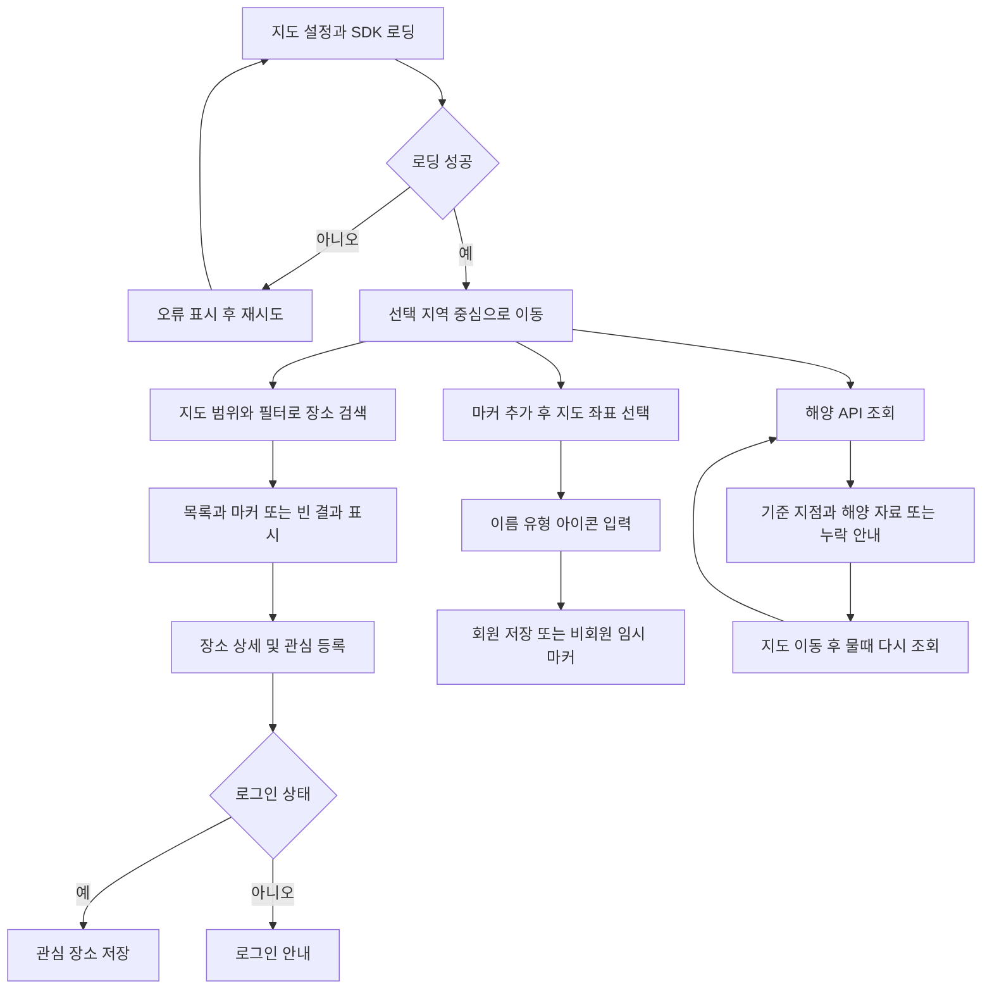

### 여행 플래너 — travel.html

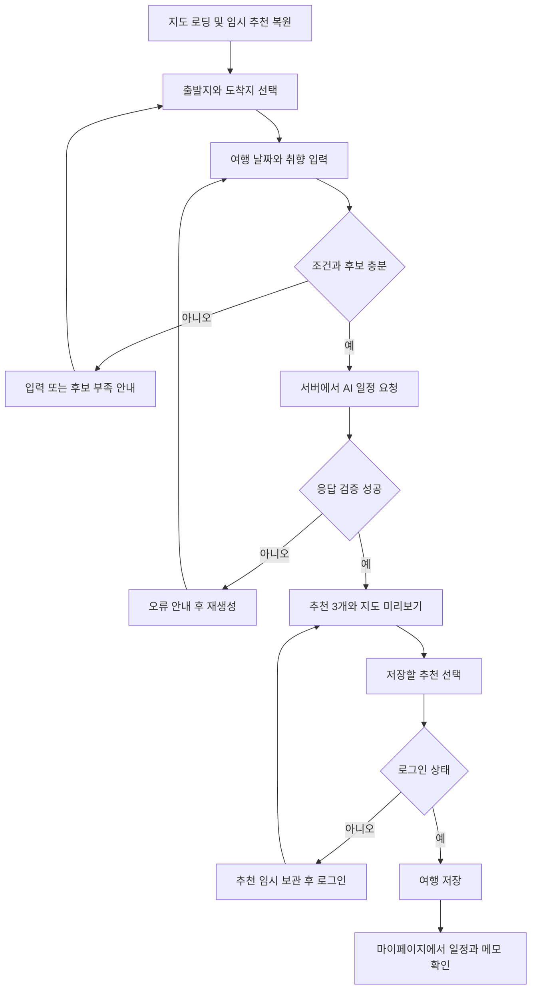

### 커뮤니티 — community.html

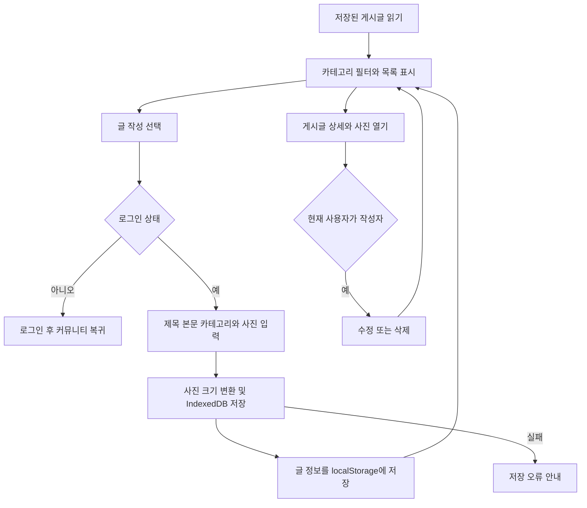

### 로그인 — login.html

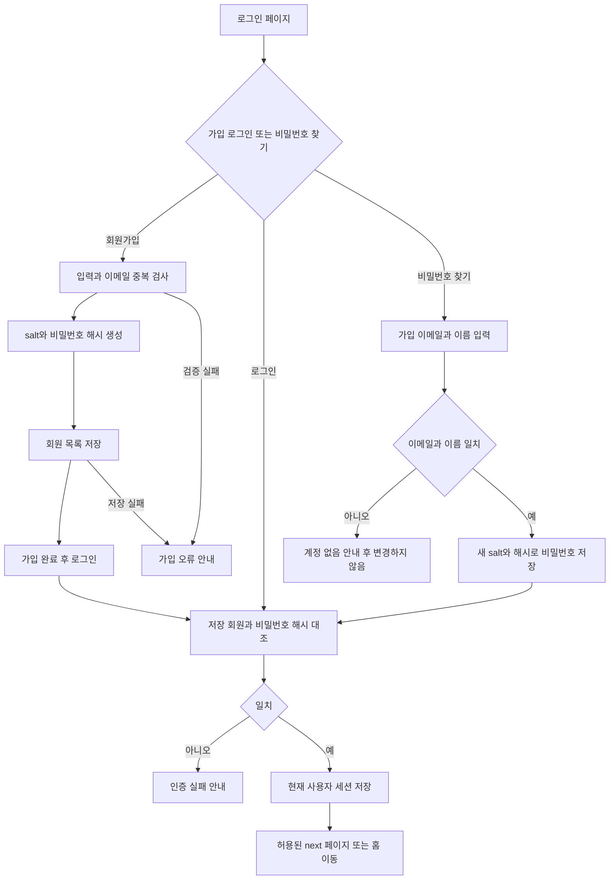

### 마이페이지 — mypage.html

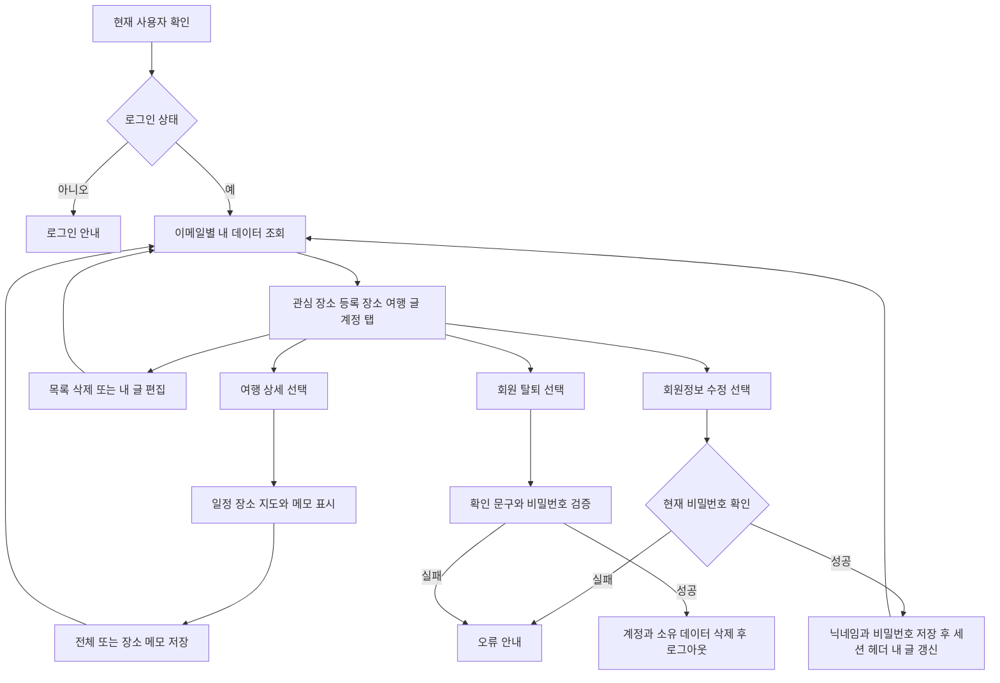

## 파일 구조와 역할

```text
.
├── README.md                 # 팀 정보, 요구사항 구현 현황, 기능별 구현 내용과 실행·데이터 명세
├── requirements.md           # 요구사항 문서
├── server.cjs                # 정적 파일 제공, 환경변수, 공공 API·장소 사진 및 AI 프록시
├── index.html                # 지역 선택 홈과 날씨 창
├── map.html                  # 지도 탐색, 마커 등록, 해양 정보
├── travel.html               # AI 여행 플래너
├── community.html            # 게시글 목록·상세·작성·편집
├── login.html                # 로그인, 회원가입, 비밀번호 찾기
├── mypage.html               # 내 데이터, 여행 메모, 계정 관리(회원정보 수정·탈퇴)
├── js/
│   ├── session.js            # 공통 저장소·세션·비밀번호 해시·이미지 DB·지도 SDK·지역 좌표 처리
│   ├── main.js               # 홈 지역 SVG 선택과 모든 페이지 헤더의 날짜·날씨 UI
│   ├── map.js                # 지도 장소 검색·관심 등록·마커·대표 사진·해양 UI
│   ├── travel.js             # 후보 검색·AI 요청·추천 검증·미리보기·저장
│   ├── community.js          # 게시글 CRUD와 사진 변환·첨부
│   ├── login.js              # 회원가입·비밀번호 해시·로그인·비밀번호 찾기
│   └── mypage.js             # 내 목록·삭제·여행 상세·메모·회원정보 수정·회원 탈퇴
├── css/
│   ├── main.css              # 공통 스타일·헤더·홈
│   ├── map.css               # 지도 탐색 스타일
│   ├── travel.css            # 플래너 스타일
│   ├── community.css         # 커뮤니티 스타일
│   ├── login.css             # 로그인 스타일
│   └── mypage.css            # 마이페이지 스타일
├── img/
│   ├── gif/                  # 기능별 시연 화면영상 GIF 13개 (README에 삽입)
│   ├── icons/                # 브랜드 이미지와 유형별 SVG 마커
│   └── reference_layout/     # 화면 디자인 참고 이미지
├── json/
│   └── user.json             # 기존 JSON 파일. 현재 회원 저장 대상은 아님
├── tests/
│   └── login.test.cjs        # 로그인·회원가입·비밀번호 찾기 저장 경계 테스트
├── .gitignore                # 환경변수 파일 등 Git 제외 규칙
└── .env                      # 로컬 실행 설정. 별도 준비하며 Git에 포함하지 않음
```

**연결 관계:** 각 HTML은 공통 `session.js`와 페이지 전용 JS를 로드합니다. 공통 JS는 `window.Kkuni`를 통해 세션·저장소·지도 로딩 기능을 제공합니다. 페이지 JS는 DOM 이벤트를 처리하고 공공 데이터와 AI가 필요한 경우 `server.cjs`의 API를 요청합니다. 사용자 데이터는 서버 파일에 쓰지 않으며, 서버 재시작과 별개로 브라우저에 남습니다.

### 환경변수 예시

별도 npm 설치 없이 Node.js 내장 모듈로 실행합니다. `package.json` 기반 실행 스크립트는 없으며 실행 명령은 앞의 `node server.cjs`입니다. 아래 값은 실제 인증키가 아닌 작성 예시입니다.

```dotenv
PORT=5500
KAKAO_MAP_KEY=YOUR_KAKAO_JAVASCRIPT_KEY
DATA_GO_KR_KEY=YOUR_DATA_GO_KR_SERVICE_KEY
OPENAI_API_KEY=YOUR_OPENAI_API_KEY
```

- 공공 API는 해당 서비스의 활용신청과 권한이 필요합니다. `DATA_FO_KR_KEY`도 기존 오타 호환용으로 읽지만 새 설정에는 `DATA_GO_KR_KEY`를 사용합니다.
- AI는 프로젝트 `.env` 안의 `OPENAI_API_KEY` 또는 `OPEN_API_KEY`를 사용합니다. 다른 실행 환경의 키로 자동 대체하지 않습니다.
- 엔드포인트를 생략하면 서버 기본 주소를 사용합니다. 필요하면 `KMA_VILAGE_FCST_ENDPOINT`, `KMA_WTHR_WRN_ENDPOINT`, `KHOA_TIDE_FCST_HGH_LW_ENDPOINT`, `KHOA_DT_RECENT_ENDPOINT`, `KHOA_FCST_FISHING_V2_ENDPOINT`, `KASI_RISE_SET_ENDPOINT`, `KASI_LRSR_CLD_ENDPOINT`, `KTO_TOUR_ENDPOINT`를 지정합니다.
- 관광공사 국문관광정보서비스(대표 사진)는 `DATA_GO_KR_KEY`로 호출하므로 같은 인증키로 해당 서비스 활용신청이 필요합니다.
- `KAKAO_REST_API_KEY`(선택)는 카카오 앱의 REST API 키입니다. 설정하면 관광공사에 사진이 없는 장소에 카카오 이미지 검색 결과를 사용합니다. 서버에서만 사용하고 브라우저에 전달하지 않습니다.
- 서버는 `127.0.0.1`에 바인딩합니다. 다른 기기에서 접속하는 배포 서버 설정은 포함하지 않습니다.

## 트러블슈팅

과거 개발 기록과 현재 코드에서 확인한 사례입니다. 아래 해결 결과는 해당 기록 또는 구현 확인 범위이며, 현재 외부 API를 모두 다시 호출해 검증했다는 뜻은 아닙니다.

### 1. 카카오 지도에서 domain mismatched 발생

- **증상:** 개발 당시 `http://127.0.0.1:4173`에서 SDK 요청이 `401 AccessDeniedError: domain mismatched`로 실패했습니다.
- **원인:** 실행하는 사이트 주소가 카카오 앱의 허용 웹 도메인과 일치하지 않았습니다.
- **해결:** 실제 호스트와 포트를 Kakao Developers에 등록하고, 등록된 개발 주소에 맞춰 접속했습니다. `localhost`와 `127.0.0.1`, 서로 다른 포트는 각각 확인해야 합니다.
- **확인 결과:** 2026-10-02 개발 기록에 지도 검색·마커 폼·아이콘의 브라우저 확인이 남아 있습니다. 현재 콘솔 등록 상태는 이 저장소만으로 확인할 수 없습니다.

### 2. 서버 경유 SDK 주소에서 지도 초기화 설정을 읽지 못함

- **증상:** SDK 스크립트 주소를 자체 `/api/kakao-map-sdk`로 지정하고 리다이렉트하는 방식만으로는 초기화에 필요한 키·라이브러리 설정을 정상적으로 전달하기 어렵습니다.
- **원인:** 카카오 SDK가 DOM의 실제 `script.src`를 읽어 키와 라이브러리를 찾기 때문에 HTTP 리다이렉트만으로 해당 속성이 공식 주소로 바뀌지 않습니다.
- **해결:** `/api/kakao-map-config`에서 공식 SDK URL을 받은 뒤, `session.js`가 그 주소를 `script.src`에 지정합니다. `autoload=false`와 `kakao.maps.load`로 초기화 순서를 제어합니다.
- **확인 결과:** 현재 코드에서 URL 허용 검사, 로딩 제한시간, 실패 스크립트 제거, 재시도 처리를 확인했습니다. JavaScript 지도 키는 브라우저에 전달되며, 공공 데이터·OpenAI 키와 구분됩니다.

### 3. 발표가 없는 날 기상특보를 확인하지 못함

- **증상:** 오늘 발표 목록만 조회하면 발표가 없는 날 제공기관 코드 `03`이 반환되어 이전에 발표된 유효 특보를 보여주지 못했습니다.
- **원인:** 당일 발표 목록과 최신 특보 현황의 의미가 다릅니다.
- **해결:** `getPwnStatus`로 최신 전국 현황을 조회하고 발표·현황 기준시각을 표시합니다. `none`, `no_data`, `unavailable`, `ok` 상태를 구분합니다.
- **확인 결과:** 현재 `getWeather`와 `normalizeAlertStatus`, 홈 렌더링 코드에 현황 조회와 상태 구분이 반영되어 있습니다.

### 4. 오늘 시간별 예보가 일부 시간만 표시됨

- **증상:** 최신 발표만 사용하면 이미 지난 오늘 이른 시간 예보가 빠질 수 있습니다. 23시 발표는 다음 날 예보를 중심으로 제공합니다.
- **원인:** 단기예보는 발표 시점 이후의 시간대를 제공하기 때문에 최신 응답 하나로 오늘 전체를 채울 수 없습니다.
- **해결:** 전날 23시 예보와 최신 예보를 시간별로 합칩니다. 오늘 23시 이후에는 오늘 20시 발표를 사용하고, 최신 발표가 자료 없음이면 3시간 이전 발표를 재조회합니다.
- **확인 결과:** 현재 서버에 병합·중복 교체·발표시각 계산이 구현되어 있습니다. 그래도 자료가 없는 시간은 누락 안내를 표시합니다.

### 5. 내륙 좌표에서 해양 자료가 없거나 수온이 0으로 표시됨

- **증상:** 지도 중심 주변에 기준 관측소가 없거나, 제공기관 관측값의 수온과 염분이 모두 0일 수 있습니다.
- **원인:** 해양 관측은 모든 좌표를 대상으로 제공되지 않으며, 응답 수치가 있어도 유효성을 확정할 수 없는 경우가 있습니다.
- **해결:** 등록 관측소·예보 지점을 35km 이내로 제한하고, 기준 지점과 거리를 함께 표시합니다. 지점 없음과 API 실패를 구분하며 수온의 유효성 안내를 반환합니다.
- **확인 결과:** 현재 `nearestStation`과 `getMarine`의 거리 제한·부분 실패·0값 안내 로직을 확인했습니다. 데이터가 없는 곳은 해안으로 이동 후 다시 조회할 수 있습니다.

### 6. 새로고침 또는 주소 변경 후 내 데이터가 보이지 않음

- **증상:** 다른 브라우저·호스트·포트로 실행하면 기존 계정과 저장 여행이 보이지 않을 수 있고, 회원가입 후 `json/user.json`이 바뀌지 않습니다.
- **원인:** 현재 저장 방식은 브라우저의 출처별 localStorage·IndexedDB이며 파일 또는 중앙 DB에 저장하지 않습니다. 로그인 상태·지역·추천 초안은 sessionStorage를 사용합니다.
- **해결:** 같은 브라우저와 같은 주소로 실행하고 개발자 도구의 저장소를 확인합니다. 브라우저 간 공유가 필요하면 별도의 서버 계정·DB 구현이 필요합니다.
- **확인 결과:** 현재 코드의 저장소 키와 로그인 테스트에서 계정 저장 후 재접속 로그인 동작을 확인할 수 있습니다. 로컬 계정 검증은 실제 서비스의 서버 인증을 대신하지 않습니다.

### 7. AI 여행 추천의 키·권한·한도·응답 오류

- **증상:** 추천 생성이 실패하면서 키 설정, 모델 권한, 결제·사용 한도 또는 응답 오류 안내가 나타날 수 있습니다.
- **원인:** 프로젝트 `.env`의 키 누락, API 401/403/429, 연결 제한시간, 후보 부족 또는 생성 결과의 검증 실패입니다.
- **해결:** `.env`의 키를 설정하고 서버를 다시 실행합니다. 권한·한도를 확인하거나, 조건과 도착지를 바꿔 후보를 확보한 뒤 재생성합니다. 실패 시 임의 일정으로 대체하지 않습니다.
- **확인 결과:** 현재 서버에 오류별 응답과 Structured Outputs·후보 ID·날짜·서로 다른 조합 검증이 구현되어 있습니다. 모델의 현재 접근 가능 여부는 실제 계정으로 호출해야 확인할 수 있습니다.

### 8. 닉네임을 바꿔도 이전 글과 헤더에 예전 이름이 남음

- **증상:** 회원 목록의 이름만 바꾸면 헤더의 `이름님`과 커뮤니티 글의 작성자는 예전 닉네임으로 남습니다.
- **원인:** 로그인 상태는 `sessionStorage`에 이름을 따로 보관하고, 게시글은 작성 당시의 `author`를 저장합니다.
- **해결:** 회원정보 수정 시 `setCurrentUser`로 세션을 갱신하고 `renderHeaderUser`로 헤더를 다시 그립니다. 본인 이메일로 작성한 글의 `author`도 새 닉네임으로 바꿉니다.
- **확인 결과:** 브라우저에서 닉네임 변경 후 세션·헤더·계정 정보·테스트 게시글의 작성자 이름이 함께 바뀌는 것을 확인했습니다.

### 9. 대표 사진이 다른 장소의 사진으로 나옴

- **증상:** 이름이 포함되기만 하면 같은 장소로 보던 초기 구현에서 `경복궁` 마커에 근처 한복 대여점 `한복남 경복궁점`의 사진이 나왔습니다.
- **원인:** 좌표 거리순 결과에서 이름에 `경복궁`이 들어간 첫 장소를 골랐기 때문입니다.
- **해결:** 이름 일치를 점수로 바꿔 같은 이름을 우선하고, 부분 일치는 겹치는 길이 비율 0.6 이상만 인정합니다.
- **확인 결과:** `경복궁`→`경복궁`, `국립현대미술관 서울관`→`국립현대미술관 서울`, `청풍호반케이블카`→`청풍호반케이블카` 사진이 나오고, 관광공사에 없는 `은성낚시공원`은 기본 이미지로 표시됩니다. 관광공사 제목이 `제천 의림지와 제림`처럼 크게 다른 장소는 잘못된 사진을 피하기 위해 기본 이미지로 둡니다.

### 10. 5500 포트에서 지도·날씨 API가 404로 실패함

- **증상:** VS Code Live Server가 5500 포트를 쓰는 동안 페이지는 열리지만 `/api/kakao-map-config`, `/api/weather`가 `Cannot GET`으로 실패합니다.
- **원인:** Live Server는 정적 파일만 제공하며 `server.cjs`의 API가 없습니다. 같은 포트에서 `node server.cjs`도 시작할 수 없습니다.
- **해결:** Live Server를 끄고 `node server.cjs`로 실행합니다. 다른 포트를 쓰려면 `PORT=4173 node server.cjs`처럼 환경변수를 지정하되(환경변수가 `.env`보다 우선), 그 주소를 카카오 콘솔에도 등록해야 지도가 열립니다.

## 검증 범위

`node --test`의 9개 테스트는 회원 정보 저장 후 재접속 로그인, 중복 가입, 틀린 비밀번호, 손상된 JSON, 저장 실패, 가입 취소, 비밀번호 찾기(성공 후 이전 비밀번호 거부, 이름 불일치 시 미변경), 데모 로그인을 검사합니다. 회원정보 수정과 로그아웃은 로컬 서버의 브라우저에서 입력 검증(변경 없음·8자 미만·확인 불일치·현재 비밀번호 누락·오류), 닉네임·비밀번호 변경, 로그아웃 후 이전 비밀번호 거부, 비밀번호 찾기 후 재로그인 흐름으로 확인했습니다. 공통 헤더는 6개 페이지를 1280·1000·375px 폭으로 열어 날씨 버튼과 로그인 버튼의 위치·크기가 모두 같고 가로 스크롤이 없음을 측정했고, 홈이 아닌 페이지에서도 날씨 창이 열리는 것을 확인했습니다. 대표 사진 API는 관광공사 등록 장소의 사진 반환, 미등록 장소의 `null`, 잘못된 이름·좌표의 400 응답을 확인했습니다. 화면영상 13개는 실제 서버에서 회원가입 → 로그인 → 지역·날씨 → 지도 탐색·대표 사진 → 마커 등록 → 해양 정보 → AI 추천 생성·저장 → 여행 메모 → 커뮤니티 작성·수정·삭제 → 마이페이지 → 회원정보 수정 → 로그아웃·비밀번호 찾기 → 회원 탈퇴를 한 흐름으로 실행해 녹화했으며, 녹화 시점(2026-10-04)에 카카오 지도·공공데이터·AI API가 모두 응답했습니다. 이 테스트가 공공 API·카카오 지도·AI API의 현재 가용성을 검증하지는 않습니다. 외부 연동은 실행 후 지역 선택과 날씨 조회, 지도 검색과 해양 재조회, 추천 생성과 여행 저장·메모 복원을 별도로 확인해야 합니다.

## 제출 파일 구성

| 제출 항목                   | 내용                                                                                       |
| --------------------------- | ------------------------------------------------------------------------------------------ |
| GitLab 프로젝트             | 관통 프로젝트 완료 후 최종 commit 반영                                                     |
| README.md                   | 팀 정보, 필수·추가·심화 구현 현황, 기능별 작업 내용과 관련 Source                          |
| 기능별 화면영상             | `img/gif/`의 기능별 GIF 13개 — 각 기능 절에 삽입                                           |
| 프로젝트 압축 파일          | `SSAFY16_광주4_관통_FrontEnd_8팀_김정호_이민호.zip`                                        |

압축 파일에는 실제 API 키가 들어 있는 `.env`를 넣지 않습니다. 커밋된 파일만 묶는 `git archive`를 사용하면 `.env`와 Git이 추적하지 않는 파일은 자동으로 제외됩니다. 최종 commit 후에 실행합니다.

```bash
git archive --format=zip -o "SSAFY16_광주4_관통_FrontEnd_8팀_김정호_이민호.zip" HEAD
```
